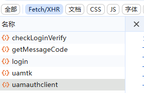
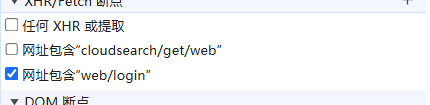
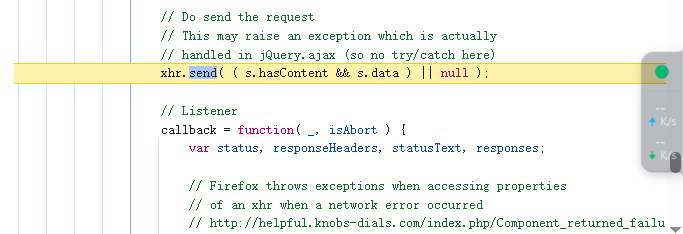
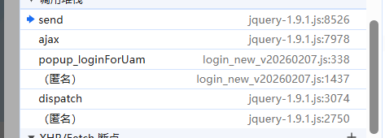
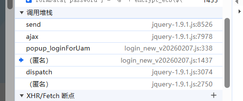
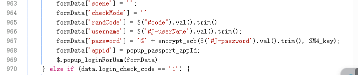
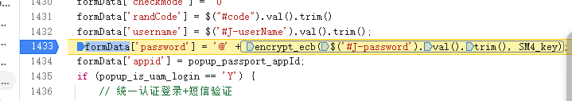
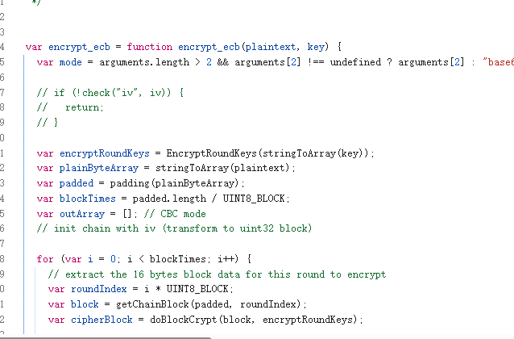

# 12306登录接口逆向

**本文章仅用于技术学习，禁止用于非法用途**

目标网站:`https://kyfw.12306.cn/otn/resources/login.html`

## 1 数据包分析

打开开发者工具，勾选上保留日志，完成登录便可以抓到以下数据包。



分析数据包，发现12306采用的是**多步链式授权登录**。

第一个数据包`checkLoginVerify`应该是用来下发基础cookie(会话标识，设备指纹。)
注：12306会校验`TlS`指纹，指纹异常，验证码接口会被直接拒绝。

第二个数据包`getMessageCode`看名字就是用来下发验证码的。

第三个数据包`login`就是用来登录的，12306会在这里进行密码 验证码和指纹校验，TLS指纹异常会被直接拒绝。

第四个数据包`uamtk`用来下发`tk`票据。

最后一个数据包`uamauthclient`进行票据回调，验证票据合法性并同步会话。

这便是我们这次要模拟的整个流程。

## 2 定位加密位置。

分析完整个数据包后，我们发现整个流程中，只有`login`数据包的`password`参数是加密的，这个需要我们进行js逆向。

因为这个请求是XHR请求，所以我们需要打一个XHR断点，网址包含`web/login`。



重新登录，发现此时断点断在这个位置。





分析堆栈发现，当调用堆栈在这个位置是，我们找到了加密参数`formData`




看到这个，不出意外就是我们要找的加密参数了，我们在967行打一个断点测试一下。

发现断点没有命中，这是因为12306有很多登录接口，所以我们按`Ctrl+f`搜索一下`encrypt_ecb($('#J-password').val().trim(), SM4_key)`这行代码。

发现搜索到了4个，我们把每一个都打一个断点，再次登录。

发现断点命中在这个位置。



```javascript
formData['password'] = '@' + encrypt_ecb($('#J-password').val().trim(), SM4_key);
```

在控制台执行`$('#J-password').val().trim()`这行代码，发现它就是我们的密码明文,`SM4_key`是一串固定值：`tiekeyuankp12306`。

在`encrypt_ecb`这个位置按下F11，跳转到这个位置。



```javascript

var stringToArray = function stringToArray(str) {
  if (!/string/gi.test(Object.prototype.toString.call(str))) {
    str = JSON.stringify(str);
  }

  return unescape(encodeURIComponent(str)).split("").map(function (val) {
    return val.charCodeAt();
  });
};

var EncryptRoundKeys = function EncryptRoundKeys(key) {
  var keys = [];
  var mk = [key[0] << 24 | key[1] << 16 | key[2] << 8 | key[3], key[4] << 24 | key[5] << 16 | key[6] << 8 | key[7], key[8] << 24 | key[9] << 16 | key[10] << 8 | key[11], key[12] << 24 | key[13] << 16 | key[14] << 8 | key[15]];
  var k = new Array(36);
  k[0] = mk[0] ^ FK[0];
  k[1] = mk[1] ^ FK[1];
  k[2] = mk[2] ^ FK[2];
  k[3] = mk[3] ^ FK[3];

  for (var i = 0; i < 32; i++) {
    k[i + 4] = k[i] ^ tTransform2(k[i + 1] ^ k[i + 2] ^ k[i + 3] ^ CK[i]);
    keys[i] = k[i + 4];
  }

  return keys;
};

var getChainBlock = function getChainBlock(arr) {
  var baseIndex = arguments.length > 1 && arguments[1] !== undefined ? arguments[1] : 0;
  var block = [arr[baseIndex] << 24 | arr[baseIndex + 1] << 16 | arr[baseIndex + 2] << 8 | arr[baseIndex + 3], arr[baseIndex + 4] << 24 | arr[baseIndex + 5] << 16 | arr[baseIndex + 6] << 8 | arr[baseIndex + 7], arr[baseIndex + 8] << 24 | arr[baseIndex + 9] << 16 | arr[baseIndex + 10] << 8 | arr[baseIndex + 11], arr[baseIndex + 12] << 24 | arr[baseIndex + 13] << 16 | arr[baseIndex + 14] << 8 | arr[baseIndex + 15]];
  return block;
};

var doBlockCrypt = function doBlockCrypt(blockData, roundKeys) {
  var xBlock = new Array(36);
  blockData.forEach(function (val, index) {
    return xBlock[index] = val;
  }); // loop to process 32 rounds crypt

  for (var i = 0; i < 32; i++) {
    xBlock[i + 4] = xBlock[i] ^ tTransform1(xBlock[i + 1] ^ xBlock[i + 2] ^ xBlock[i + 3] ^ roundKeys[i]);
  }

  var yBlock = [xBlock[35], xBlock[34], xBlock[33], xBlock[32]];
  return yBlock;
};

var padding = function padding(originalBuffer) {
  if (originalBuffer === null) {
    return null;
  }

  var paddingLength = UINT8_BLOCK - originalBuffer.length % UINT8_BLOCK;
  var paddedBuffer = new Array(originalBuffer.length + paddingLength);
  originalBuffer.forEach(function (val, index) {
    return paddedBuffer[index] = val;
  });

  // paddedBuffer.fill(paddingLength, originalBuffer.length); // IE 11 及更早版本不支持 fill() 方法

  for(var i=0;i<paddingLength;i++){
    originalBuffer.push(paddingLength)
  }
  paddedBuffer = originalBuffer;

  return paddedBuffer;
};


var encrypt_ecb = function encrypt_ecb(plaintext, key) {
  var mode = arguments.length > 2 && arguments[2] !== undefined ? arguments[2] : "base64";

  // if (!check("iv", iv)) {
  //   return;
  // }

  var encryptRoundKeys = EncryptRoundKeys(stringToArray(key));
  var plainByteArray = stringToArray(plaintext);
  var padded = padding(plainByteArray);
  var blockTimes = padded.length / UINT8_BLOCK;
  var outArray = []; // CBC mode
  // init chain with iv (transform to uint32 block)

  for (var i = 0; i < blockTimes; i++) {
    // extract the 16 bytes block data for this round to encrypt
    var roundIndex = i * UINT8_BLOCK;
    var block = getChainBlock(padded, roundIndex);
    var cipherBlock = doBlockCrypt(block, encryptRoundKeys);

    for (var l = 0; l < UINT8_BLOCK; l++) {
      outArray[roundIndex + l] = cipherBlock[parseInt(l / 4)] >> (3 - l) % 4 * 8 & 0xff;
    }
  } // cipher array to string


  if (mode === 'base64') {
    return base64js.fromByteArray(outArray);
  } else {
    // text
    return decodeURIComponent(escape(String.fromCharCode.apply(String, outArray)));
  }
};
```

## 3 加密逻辑分析

```javascript
var stringToArray = function stringToArray(str) {
  if (!/string/gi.test(Object.prototype.toString.call(str))) {
    str = JSON.stringify(str);
  }

  return unescape(encodeURIComponent(str)).split("").map(function (val) {
    return val.charCodeAt();
  });
};
```
作用：把输入转成字节数组。

分两种情况：

1 如果 str 是字符串：

encodeURIComponent(str) 按 UTF-8 做百分号编码；

unescape(...) 把 %XX 解成 Latin-1 字符；

charCodeAt() 得到 0~255 的字节值。

2 如果 str 不是字符串：

先 JSON.stringify(str)；

再按上面逻辑转 UTF-8 字节。

```javascript
var EncryptRoundKeys = function EncryptRoundKeys(key) {
  var keys = [];
  var mk = [
    key[0] << 24 | key[1] << 16 | key[2] << 8 | key[3],
    key[4] << 24 | key[5] << 16 | key[6] << 8 | key[7],
    key[8] << 24 | key[9] << 16 | key[10] << 8 | key[11],
    key[12] << 24 | key[13] << 16 | key[14] << 8 | key[15]
  ];
  var k = new Array(36);
  k[0] = mk[0] ^ FK[0];
  k[1] = mk[1] ^ FK[1];
  k[2] = mk[2] ^ FK[2];
  k[3] = mk[3] ^ FK[3];

  for (var i = 0; i < 32; i++) {
    k[i + 4] = k[i] ^ tTransform2(k[i + 1] ^ k[i + 2] ^ k[i + 3] ^ CK[i]);
    keys[i] = k[i + 4];
  }

  return keys;
};
```

作用：SM4 密钥扩展，生成 32 个轮密钥。

```javascript
var getChainBlock = function getChainBlock(arr) {
  var baseIndex = arguments.length > 1 && arguments[1] !== undefined ? arguments[1] : 0;
  var block = [
    arr[baseIndex] << 24 | arr[baseIndex + 1] << 16 | arr[baseIndex + 2] << 8 | arr[baseIndex + 3],
    arr[baseIndex + 4] << 24 | arr[baseIndex + 5] << 16 | arr[baseIndex + 6] << 8 | arr[baseIndex + 7],
    arr[baseIndex + 8] << 24 | arr[baseIndex + 9] << 16 | arr[baseIndex + 10] << 8 | arr[baseIndex + 11],
    arr[baseIndex + 12] << 24 | arr[baseIndex + 13] << 16 | arr[baseIndex + 14] << 8 | arr[baseIndex + 15]
  ];
  return block;
};
```

作用：从字节数组中取 16 字节，按大端拼成 4 个 32 位字

```javascript
var doBlockCrypt = function doBlockCrypt(blockData, roundKeys) {
  var xBlock = new Array(36);
  blockData.forEach(function (val, index) {
    return xBlock[index] = val;
  });

  for (var i = 0; i < 32; i++) {
    xBlock[i + 4] = xBlock[i] ^ tTransform1(
      xBlock[i + 1] ^ xBlock[i + 2] ^ xBlock[i + 3] ^ roundKeys[i]
    );
  }

  var yBlock = [xBlock[35], xBlock[34], xBlock[33], xBlock[32]];
  return yBlock;
};
```

作用：SM4 单块加密，输入 4 个 32 位字，输出 4 个 32 位密文字。

```javascript
var padding = function padding(originalBuffer) {
  if (originalBuffer === null) {
    return null;
  }

  var paddingLength = UINT8_BLOCK - originalBuffer.length % UINT8_BLOCK;
  var paddedBuffer = new Array(originalBuffer.length + paddingLength);
  originalBuffer.forEach(function (val, index) {
    return paddedBuffer[index] = val;
  });

  for(var i=0;i<paddingLength;i++){
    originalBuffer.push(paddingLength)
  }
  paddedBuffer = originalBuffer;

  return paddedBuffer;
};
```

作用：PKCS#7 填充。

注意这里的实现细节：

paddingLength = 16 - len % 16，范围是 1~16；

先创建了 paddedBuffer 并复制，但后面又 paddedBuffer = originalBuffer，所以真正返回的是被 push 修改后的原数组；

即使原始长度正好是 16 的倍数，也会补 16 个 0x10。

```javascript
var encrypt_ecb = function encrypt_ecb(plaintext, key) {
  var mode = arguments.length > 2 && arguments[2] !== undefined ? arguments[2] : "base64";

  var encryptRoundKeys = EncryptRoundKeys(stringToArray(key));
  var plainByteArray = stringToArray(plaintext);
  var padded = padding(plainByteArray);
  var blockTimes = padded.length / UINT8_BLOCK;
  var outArray = [];

  for (var i = 0; i < blockTimes; i++) {
    var roundIndex = i * UINT8_BLOCK;
    var block = getChainBlock(padded, roundIndex);
    var cipherBlock = doBlockCrypt(block, encryptRoundKeys);

    for (var l = 0; l < UINT8_BLOCK; l++) {
      outArray[roundIndex + l] =
        cipherBlock[parseInt(l / 4)] >> (3 - l) % 4 * 8 & 0xff;
    }
  }

  if (mode === 'base64') {
    return base64js.fromByteArray(outArray);
  } else {
    return decodeURIComponent(escape(String.fromCharCode.apply(String, outArray)));
  }
};
```

流程：

EncryptRoundKeys(stringToArray(key)) 生成 32 个轮密钥；

stringToArray(plaintext) 得到明文字节；

padding 做 PKCS#7；

每 16 字节一块；

每块 getChainBlock 转 4 个 32 位字；

doBlockCrypt 做 SM4 单块加密；

把 4 个 32 位密文字按大端拆回 16 字节；

根据 mode 输出 Base64 或 UTF-8 文本。

python 完整复现

```python
import base64
import json
import math

UINT8_BLOCK = 16
MASK32 = 0xFFFFFFFF

# SM4 S 盒
SBOX = [
    0xd6,0x90,0xe9,0xfe,0xcc,0xe1,0x3d,0xb7,0x16,0xb6,0x14,0xc2,0x28,0xfb,0x2c,0x05,
    0x2b,0x67,0x9a,0x76,0x2a,0xbe,0x04,0xc3,0xaa,0x44,0x13,0x26,0x49,0x86,0x06,0x99,
    0x9c,0x42,0x50,0xf4,0x91,0xef,0x98,0x7a,0x33,0x54,0x0b,0x43,0xed,0xcf,0xac,0x62,
    0xe4,0xb3,0x1c,0xa9,0xc9,0x08,0xe8,0x95,0x80,0xdf,0x94,0xfa,0x75,0x8f,0x3f,0xa6,
    0x47,0x07,0xa7,0xfc,0xf3,0x73,0x17,0xba,0x83,0x59,0x3c,0x19,0xe6,0x85,0x4f,0xa8,
    0x68,0x6b,0x81,0xb2,0x71,0x64,0xda,0x8b,0xf8,0xeb,0x0f,0x4b,0x70,0x56,0x9d,0x35,
    0x1e,0x24,0x0e,0x5e,0x63,0x58,0xd1,0xa2,0x25,0x22,0x7c,0x3b,0x01,0x21,0x78,0x87,
    0xd4,0x00,0x46,0x57,0x9f,0xd3,0x27,0x52,0x4c,0x36,0x02,0xe7,0xa0,0xc4,0xc8,0x9e,
    0xea,0xbf,0x8a,0xd2,0x40,0xc7,0x38,0xb5,0xa3,0xf7,0xf2,0xce,0xf9,0x61,0x15,0xa1,
    0xe0,0xae,0x5d,0xa4,0x9b,0x34,0x1a,0x55,0xad,0x93,0x32,0x30,0xf5,0x8c,0xb1,0xe3,
    0x1d,0xf6,0xe2,0x2e,0x82,0x66,0xca,0x60,0xc0,0x29,0x23,0xab,0x0d,0x53,0x4e,0x6f,
    0xd5,0xdb,0x37,0x45,0xde,0xfd,0x8e,0x2f,0x03,0xff,0x6a,0x72,0x6d,0x6c,0x5b,0x51,
    0x8d,0x1b,0xaf,0x92,0xbb,0xdd,0xbc,0x7f,0x11,0xd9,0x5c,0x41,0x1f,0x10,0x5a,0xd8,
    0x0a,0xc1,0x31,0x88,0xa5,0xcd,0x7b,0xbd,0x2d,0x74,0xd0,0x12,0xb8,0xe5,0xb4,0xb0,
    0x89,0x69,0x97,0x4a,0x0c,0x96,0x77,0x7e,0x65,0xb9,0xf1,0x09,0xc5,0x6e,0xc6,0x84,
    0x18,0xf0,0x7d,0xec,0x3a,0xdc,0x4d,0x20,0x79,0xee,0x5f,0x3e,0xd7,0xcb,0x39,0x48,
]

FK = [0xA3B1BAC6, 0x56AA3350, 0x677D9197, 0xB27022DC]

# SM4 系统参数 CK
CK = []
for i in range(32):
    ck = 0
    for j in range(4):
        ck = (ck << 8) | (((4 * i + j) * 7) & 0xFF)
    CK.append(ck)


def rotl32(x, n):
    x &= MASK32
    n &= 31
    if n == 0:
        return x
    return ((x << n) | (x >> (32 - n))) & MASK32


def sbox_transform(x):
    x &= MASK32
    b0 = SBOX[(x >> 24) & 0xFF]
    b1 = SBOX[(x >> 16) & 0xFF]
    b2 = SBOX[(x >> 8) & 0xFF]
    b3 = SBOX[x & 0xFF]
    return ((b0 << 24) | (b1 << 16) | (b2 << 8) | b3) & MASK32


def t_transform1(x):
    """SM4 加密轮函数 T 变换"""
    y = sbox_transform(x)
    return (
        y
        ^ rotl32(y, 2)
        ^ rotl32(y, 10)
        ^ rotl32(y, 18)
        ^ rotl32(y, 24)
    ) & MASK32


def t_transform2(x):
    """SM4 密钥扩展 T' 变换"""
    y = sbox_transform(x)
    return (y ^ rotl32(y, 13) ^ rotl32(y, 23)) & MASK32


def js_json_stringify_like(value):
    """
    尽量模拟 JS JSON.stringify 的常见行为。
    复杂对象、undefined、函数、Symbol、toJSON 等不在模拟范围内。
    """
    if value is None:
        return "null"
    if value is True:
        return "true"
    if value is False:
        return "false"
    if isinstance(value, str):
        return json.dumps(value, ensure_ascii=False)
    if isinstance(value, (int, float)):
        if isinstance(value, float) and (math.isnan(value) or math.isinf(value)):
            # JS JSON.stringify(NaN / Infinity) => "null"
            return "null"
        return json.dumps(value, ensure_ascii=False, separators=(",", ":"))
    if isinstance(value, (list, tuple)):
        return "[" + ",".join(js_json_stringify_like(v) for v in value) + "]"
    if isinstance(value, dict):
        parts = []
        for k, v in value.items():
            key = k if isinstance(k, str) else str(k)
            parts.append(
                json.dumps(key, ensure_ascii=False) + ":" + js_json_stringify_like(v)
            )
        return "{" + ",".join(parts) + "}"
    raise TypeError("unsupported type for JS JSON.stringify simulation")


def string_to_array(value):
    """
    对应 JS:
        stringToArray(str)
    """
    if isinstance(value, str):
        s = value
    else:
        s = js_json_stringify_like(value)

    # encodeURIComponent + unescape + charCodeAt 的等价结果
    return list(s.encode("utf-8"))


def encrypt_round_keys(key):
    """
    对应 JS EncryptRoundKeys(key)
    key 是字节列表。
    不足 16 字节时末尾补 0；超过 16 字节时截断。
    """
    key16 = (list(key) + [0] * 16)[:16]

    mk = [
        (key16[0] << 24) | (key16[1] << 16) | (key16[2] << 8) | key16[3],
        (key16[4] << 24) | (key16[5] << 16) | (key16[6] << 8) | key16[7],
        (key16[8] << 24) | (key16[9] << 16) | (key16[10] << 8) | key16[11],
        (key16[12] << 24) | (key16[13] << 16) | (key16[14] << 8) | key16[15],
    ]
    mk = [v & MASK32 for v in mk]

    k = [0] * 36
    k[0] = (mk[0] ^ FK[0]) & MASK32
    k[1] = (mk[1] ^ FK[1]) & MASK32
    k[2] = (mk[2] ^ FK[2]) & MASK32
    k[3] = (mk[3] ^ FK[3]) & MASK32

    keys = []
    for i in range(32):
        tmp = (k[i + 1] ^ k[i + 2] ^ k[i + 3] ^ CK[i]) & MASK32
        k[i + 4] = (k[i] ^ t_transform2(tmp)) & MASK32
        keys.append(k[i + 4])

    return keys


def get_chain_block(arr, base_index=0):
    """
    对应 JS getChainBlock(arr, baseIndex)
    16 字节按大端转 4 个 uint32。
    """
    return [
        (
            (arr[base_index] << 24)
            | (arr[base_index + 1] << 16)
            | (arr[base_index + 2] << 8)
            | arr[base_index + 3]
        ) & MASK32,
        (
            (arr[base_index + 4] << 24)
            | (arr[base_index + 5] << 16)
            | (arr[base_index + 6] << 8)
            | arr[base_index + 7]
        ) & MASK32,
        (
            (arr[base_index + 8] << 24)
            | (arr[base_index + 9] << 16)
            | (arr[base_index + 10] << 8)
            | arr[base_index + 11]
        ) & MASK32,
        (
            (arr[base_index + 12] << 24)
            | (arr[base_index + 13] << 16)
            | (arr[base_index + 14] << 8)
            | arr[base_index + 15]
        ) & MASK32,
    ]


def do_block_crypt(block_data, round_keys):
    """
    对应 JS doBlockCrypt(blockData, roundKeys)
    SM4 单块加密，返回 4 个 uint32 密文字。
    """
    x_block = [0] * 36
    x_block[0:4] = block_data

    for i in range(32):
        tmp = (
            x_block[i + 1]
            ^ x_block[i + 2]
            ^ x_block[i + 3]
            ^ round_keys[i]
        ) & MASK32
        x_block[i + 4] = (x_block[i] ^ t_transform1(tmp)) & MASK32

    return [x_block[35], x_block[34], x_block[33], x_block[32]]


def padding(original_buffer):
    """
    对应 JS padding(originalBuffer)
    PKCS#7 填充，会原地修改 original_buffer。
    """
    if original_buffer is None:
        return None

    padding_length = UINT8_BLOCK - len(original_buffer) % UINT8_BLOCK
    original_buffer.extend([padding_length] * padding_length)
    return original_buffer


def words_to_bytes(cipher_block):
    """
    对应 JS 中：
    outArray[roundIndex + l] =
      cipherBlock[parseInt(l / 4)] >> (3 - l) % 4 * 8 & 0xff;
    """
    out = []
    for l in range(UINT8_BLOCK):
        word = cipher_block[l // 4]
        shift = (3 - (l % 4)) * 8
        out.append((word >> shift) & 0xFF)
    return bytes(out)


def encrypt_ecb(plaintext, key, mode="base64"):
    """
    对应 JS:
        encrypt_ecb(plaintext, key, mode = "base64")
    """
    encrypt_round_keys_list = encrypt_round_keys(string_to_array(key))
    plain_byte_array = string_to_array(plaintext)
    padded = padding(plain_byte_array)

    block_times = len(padded) // UINT8_BLOCK
    out_array = []

    for i in range(block_times):
        round_index = i * UINT8_BLOCK
        block = get_chain_block(padded, round_index)
        cipher_block = do_block_crypt(block, encrypt_round_keys_list)
        out_array.extend(words_to_bytes(cipher_block))

    if mode == "base64":
        return base64.b64encode(bytes(out_array)).decode("ascii")
    else:
        # 对应 decodeURIComponent(escape(String.fromCharCode.apply(String, outArray)))
        return bytes(out_array).decode("utf-8")

if __name__ == "__main__":
    # 1. 验证 SM4 标准单块测试向量
    # key   = 0123456789abcdeffedcba9876543210
    # plain = 0123456789abcdeffedcba9876543210
    # cipher= 681edf34d206965e86b3e94f536e4246
    std_key = bytes.fromhex("0123456789abcdeffedcba9876543210")
    std_plain = bytes.fromhex("0123456789abcdeffedcba9876543210")

    rk = encrypt_round_keys(list(std_key))
    block_words = get_chain_block(list(std_plain), 0)
    cipher_words = do_block_crypt(block_words, rk)
    cipher_bytes = words_to_bytes(cipher_words)

    print("SM4 standard vector:", cipher_bytes.hex())
    # 应输出：
    # 681edf34d206965e86b3e94f536e4246

    # 2. 对应 JS encrypt_ecb 的调用
    result = encrypt_ecb("12345678", "tiekeyuankp12306", "base64")
    print("encrypt_ecb base64:", result)
```

总结一下，这套前端js源码实现的就是SM4-ECB 加密。下面是用python的gmssl库复现这个js。

```python
import base64
from gmssl.sm4 import CryptSM4, SM4_ENCRYPT, SM4_DECRYPT

UINT8_BLOCK = 16

def string_to_array(value):
    """模拟 JS stringToArray：字符串转 UTF-8 字节；非字符串先 JSON 序列化"""
    if isinstance(value, str):
        return value.encode("utf-8")
    else:
        import json
        return json.dumps(value, ensure_ascii=False, separators=(",", ":")).encode("utf-8")

def fix_key(key_bytes):
    """模拟 JS 中 key 不足 16 字节补 0、超过截断的行为"""
    return (key_bytes + b"\x00" * 16)[:16]

def encrypt_ecb_gmssl(plaintext, key, mode="base64"):
    key_bytes = fix_key(string_to_array(key))
    plain_bytes = string_to_array(plaintext)

    crypt_sm4 = CryptSM4()
    crypt_sm4.set_key(key_bytes, SM4_ENCRYPT)
    cipher_bytes = crypt_sm4.crypt_ecb(plain_bytes)   # 不再手动 pad

    if mode == "base64":
        return base64.b64encode(cipher_bytes).decode("ascii")
    else:
        return cipher_bytes.decode("utf-8")

# ---------- 验证 ----------
if __name__ == "__main__":
    # 使用标准测试向量验证 gmssl 底层 SM4 实现的正确性
    std_key = bytes.fromhex("0123456789abcdeffedcba9876543210")
    std_plain = bytes.fromhex("0123456789abcdeffedcba9876543210")
    crypt = CryptSM4()
    crypt.set_key(std_key, SM4_ENCRYPT)
    # 注意：标准测试向量是单块，无需填充，直接调用底层单块加密需用 crypt_ecb 且输入 16 字节
    # 这里直接加密 16 字节数据，gmssl 不会额外填充
    ct = crypt.crypt_ecb(std_plain)
    print("SM4 标准向量:", ct.hex())  # 应输出 681edf34d206965e86b3e94f536e4246

    # 复现 encrypt_ecb 的完整逻辑
    result = encrypt_ecb_gmssl("12345678", "tiekeyuankp12306", "base64")
    print("encrypt_ecb base64:", result)
```

## 4 python完整会话构建。

**因为12306有TLS指纹验证，这里就不用`requests`，用`curl_cffic`实现，它的用法与`requests`区别不大，但是它支持伪造TLS指纹

完整python代码

```python
import base64
from gmssl.sm4 import CryptSM4, SM4_ENCRYPT, SM4_DECRYPT
from curl_cffi import requests

UINT8_BLOCK = 16


def string_to_array(value):
    """模拟 JS stringToArray：字符串转 UTF-8 字节；非字符串先 JSON 序列化"""
    if isinstance(value, str):
        return value.encode("utf-8")
    else:
        import json
        return json.dumps(value, ensure_ascii=False, separators=(",", ":")).encode("utf-8")


def fix_key(key_bytes):
    """模拟 JS 中 key 不足 16 字节补 0、超过截断的行为"""
    return (key_bytes + b"\x00" * 16)[:16]

def encrypt_ecb_gmssl(plaintext, key, mode="base64"):
    key_bytes = fix_key(string_to_array(key))
    plain_bytes = string_to_array(plaintext)

    crypt_sm4 = CryptSM4()
    crypt_sm4.set_key(key_bytes, SM4_ENCRYPT)
    cipher_bytes = crypt_sm4.crypt_ecb(plain_bytes)   # 不再手动 pad

    if mode == "base64":
        return base64.b64encode(cipher_bytes).decode("ascii")
    else:
        return cipher_bytes.decode("utf-8")

# 建立会话，使用impersonate='chrome'伪造TLS指纹,浏览器尽量与ua一致
session = requests.Session(impersonate='chrome124')

username = ''
password = '@' + encrypt_ecb_gmssl("", "tiekeyuankp12306", "base64")

# 构造请求头
headers = {
    'x-requested-with':'XMLHttpRequest',
    'referer':'https://kyfw.12306.cn/otn/resources/login.html',
    'user-agent':'Mozilla/5.0 (Windows NT 10.0; Win64; x64) AppleWebKit/537.36 (KHTML, like Gecko) Chrome/124.0.0.0 Safari/537.36',
    'origin':'https://kyfw.12306.cn',
    'content-type':'application/x-www-form-urlencoded; charset=UTF-8',
    'cookie':'抓包获取'
}

def checkLoginVerify():
    url = 'https://kyfw.12306.cn/passport/web/checkLoginVerify'
    data = {
        'username': username,
        'appid':'otn'
    }
    res = session.post(url, data=data, headers=headers).json()
    return res

def getMessageCode():
    url = 'https://kyfw.12306.cn/passport/web/getMessageCode'
    data = {
        'appid':"otn",
        'username':username,
        'castNum': '你的短信'
    }
    res = session.post(url, data=data, headers=headers).json()
    return res

def login():
    url = 'https://kyfw.12306.cn/passport/web/login'
    data = {
        'sessionId':'',
        'sig':'',
        'if_check_slide_passcode_token':'',
        'scene':'',
        'checkMode':'0',
        'randCode':input('请输入验证码'),
        'username':username,
        'password':password,
        'appid':'otn'
    }
    res = session.post(url, data=data, headers=headers).json()
    return res

def uamtk():
    url = 'https://kyfw.12306.cn/passport/web/auth/uamtk'
    data = {
        'appid':'otn'
    }
    res = session.post(url, data=data, headers=headers).json()
    return res

def uamauthclient(tk):
    url = 'https://kyfw.12306.cn/otn/uamauthclient'
    data = {
        'tk':tk,
    }
    res = session.post(url, data=data, headers=headers).json()
    return res

def main():
    if not checkLoginVerify()['result_code']:
        if not getMessageCode()['result_code']:
            if not login()['result_code']:
                resp = uamtk()
                if not resp['result_code']:
                    res = uamauthclient(resp['newapptk'])
                    if not res['result_code']:
                        print(res)
                    else:
                        print('uamauthclient请求失败')
                else:
                    print('uamtk请求失败')
            else:
                print('login请求失败')
        else:
            print('getMessageCode请求失败')
    else:
        print('checkLoginVerify请求失败')

main()
```


